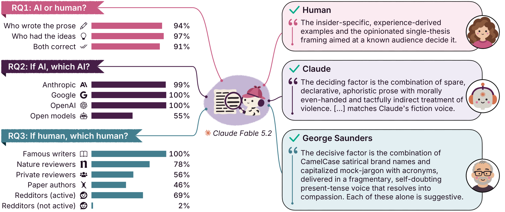

# Frontier models need only one text to unmask its human or AI author

  Atrey Desai1*, Deniz Bölöni-Turgut1*, Ty Brassington2*, Minjoon Choi1*, Jenna Russell1*, Rishanth Rajendhran1*, 
  Bradley Emi3, Hila Gonen4, Hal Daumé III1, John Wieting5, Marzena Karpinska2, Mohit Iyyer1

  1University of Maryland &nbsp; 2Simon Fraser University &nbsp; 3Pangram Labs &nbsp; 4University of British Columbia and Canada CIFAR AI Chair, Amii &nbsp; 5Google DeepMind 
  *Equal contribution

  
  

  <a href="https://atreydesai.com/blog/who-wrote-this/">Blog Post</a> &bull;
  <a href="https://model-profiles.github.io/">Model Profiles</a>

  

*Given a text sample with no candidates or external aids, Claude Fable 5.2 can readily identify AI authorship, source labs, and even human writers. Frontier models still face challenges in identifying open-weight models and less-known authors. Open models: percent of texts by open-weight writers that Fable 5.2 attributes to any open-weight model; naming the exact lab is harder.*

## Overview

Given a single text and a simple zero-shot prompt (no web access, tools, candidate lists or writing samples), frontier models can answer *"who wrote this?"* at three increasingly specific levels.

- **RQ1: Human or AI?** Whether a human or an AI originated the text's ideas, and which one wrote its prose.
- **RQ2: Which AI?** If an AI wrote it, which lab, model family and model.
- **RQ3: Which human?** If a human wrote it, often exactly who.

**Results:**
- Recent closed-source models (Claude Fable 5.2, GPT-6.1 Sol, Gemini 4 Carbon) match trained detectors like Pangram, and explain their predictions in natural language.
- Opus 5.5 names the correct lab for **98%** of texts generated by models from Anthropic, OpenAI and Google.
- Fable 5.2 correctly names the author of 39% of public peer reviews published in Oct-Nov 2026 (78% on a subset of reviews from Nature), and identifies the username behind 69% of comments from active Redditors (with >500 posts over the last year).
- Accuracy depends on exposure to an author's writing in pretraining data and on reasoning effort, and simply asking a model how familiar it is with someone predicts whether it can identify their writing.

## Repository contents

- [`prompts/`](prompts/README.md): the final prompt templates behind the paper's results, organized by research question.

## Data privacy

**We do not release any of our data.** This repository holds prompts only. It contains no texts, no author or reviewer identities, and no model predictions (aside from what is illustrated in Figure 1 above).

## License

See [LICENSE](LICENSE) for details.

## AI Use Disclosure

This repository was prepared with the help of Claude Code.
